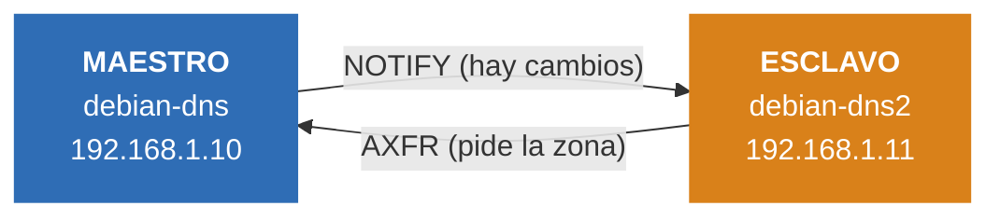

# Parte 6: Buenas prácticas del diseño de redes

*Grupo: Pau, Abde y Daniel · Módulo 0375 Servicios de red*

## 11. ¿Qué es lo recomendable a la hora de diseñar una infraestructura DNS? ¿A qué se refiere con el principio de separación estricta de funciones?

Lo recomendable es no montarlo todo en un solo servidor. Lo normal es tener dos servidores autoritativos (un primario y un secundario, mejor si están en máquinas distintas) y aparte los servidores recursivos para los equipos de la red.

La separación estricta de funciones quiere decir que cada servidor hace una sola cosa: o es autoritativo o es recursivo, pero no las dos a la vez. Así, si uno falla o recibe un ataque, el otro servicio sigue funcionando.

## 12. ¿Qué atienden los servidores autoritativos públicos? ¿Qué deberían tener totalmente desactivado?

Atienden las consultas que llegan desde Internet sobre las zonas de nuestro propio dominio, por ejemplo la IP de la web de la empresa.

Deben tener la recursividad totalmente desactivada (`recursion no;`). Si no, cualquiera podría usarlos para resolver dominios ajenos y se podrían aprovechar para ataques de amplificación DDoS. También se limita la transferencia de zona al servidor secundario con `allow-transfer`.

## 13. ¿Qué función cumplen los servidores recursivos internos o resolvers? ¿Con qué opción se restringe únicamente a los rangos IP de la organización?

Resuelven los nombres de cualquier dominio para los equipos de la red interna. Preguntan a los servidores raíz o a un forwarder y guardan la respuesta en caché para ir más rápido la próxima vez.

Para que solo contesten a los rangos de la organización se usa `allow-recursion`, por ejemplo:

```
allow-recursion { 127.0.0.1; 192.168.1.0/24; };
```

## Infografía: DNS maestro y esclavo con BIND9

Dominio `daniel.lan` · Debian 13 · BIND 9.20 · VMware

En la práctica montamos un servidor DNS esclavo (`debian-dns2`) que copia las zonas del maestro (`debian-dns`). Este es el resumen de lo que hicimos. El detalle paso a paso está en el [README principal](../README.md).



Zonas que se copian: `daniel.lan` y `1.168.192.in-addr.arpa`.

### Lo que hicimos

| Paso | Qué hicimos | Detalle |
|:---:|---|---|
| 1 | Creamos la VM del esclavo | `debian-dns2`, IP fija `192.168.1.11` en la red interna |
| 2 | Instalamos BIND9 | `apt install bind9 bind9utils bind9-doc` |
| 3 | Opciones del servidor | `allow-query` (localhost y `192.168.1.0/24`) y forwarders `1.1.1.1` y `8.8.8.8` |
| 4 | Zonas esclavas | `type slave` y `masters { 192.168.1.10; }` en `named.conf.local` |
| 5 | Permiso en el maestro | `allow-transfer` solo para `192.168.1.11`, y registros NS y A del esclavo |
| 6 | Subir el serial | `daniel.lan` de 3 a 4 y la inversa de 2 a 3. Si no, no hay transferencia |

### Comprobación

```
journalctl -xeu bind9                         →  "Transfer completed"
ls /var/cache/bind/slaves                     →  aparecen las dos zonas
dig @192.168.1.10 y @192.168.1.11 daniel.lan  →  misma respuesta
```

## Preguntas para estudiar el tema

Como pedía la actividad, le pedimos a la IA un conjunto de 10 preguntas para repasar DNS. Las dejamos aquí con una respuesta corta para poder estudiarlas.

**1. ¿Qué es el DNS y para qué sirve?**
Traduce nombres de dominio (`daniel.lan`) a direcciones IP y al revés, para no tener que memorizar números.

**2. ¿Qué diferencia hay entre un servidor autoritativo y uno recursivo?**
El autoritativo contesta solo sobre las zonas que gestiona. El recursivo busca la respuesta preguntando a otros servidores (raíz o forwarders) y la guarda en caché.

**3. ¿Qué diferencia hay entre la zona directa y la inversa?**
La directa convierte nombres en IP (`daniel.lan`). La inversa convierte IP en nombres (`1.168.192.in-addr.arpa`) y usa registros PTR.

**4. ¿Para qué sirven los registros A, NS, SOA, PTR y CNAME?**
A: nombre a IP. NS: qué servidores llevan la zona. SOA: datos de la zona, incluido el serial. PTR: IP a nombre. CNAME: un alias que apunta a otro nombre.

**5. ¿Qué hace el servidor maestro y qué hace el esclavo? ¿Por qué tener los dos?**
El maestro tiene la zona original y es donde se edita. El esclavo guarda una copia. Con los dos, si el maestro se cae, el esclavo sigue contestando.

**6. ¿Cómo se sincronizan maestro y esclavo?**
El maestro avisa con NOTIFY cuando hay cambios y el esclavo pide la zona completa con una transferencia AXFR.

**7. ¿Por qué hay que subir el serial del SOA después de cambiar una zona?**
El esclavo compara el serial con el que ya tiene. Si no sube, cree que no hay cambios y no pide la transferencia.

**8. ¿Qué hace `allow-transfer` y por qué conviene limitarlo?**
Indica quién puede pedir una copia de la zona. Si se deja abierto, cualquiera podría descargar todos los nombres de la red, así que lo limitamos a la IP del esclavo.

**9. ¿Qué hacen `recursion no;` y `allow-recursion`?**
`recursion no;` apaga la recursividad en un servidor autoritativo público, para que no lo usen en ataques de amplificación. `allow-recursion` deja la recursividad solo a los rangos de la organización.

**10. ¿Qué comandos usamos para comprobar que todo funciona?**
`named-checkconf` y `named-checkzone` para revisar la configuración y las zonas, `rndc reload` para recargar, `journalctl -xeu bind9` para ver los logs y `dig @IP dominio` para comparar las respuestas de maestro y esclavo.
