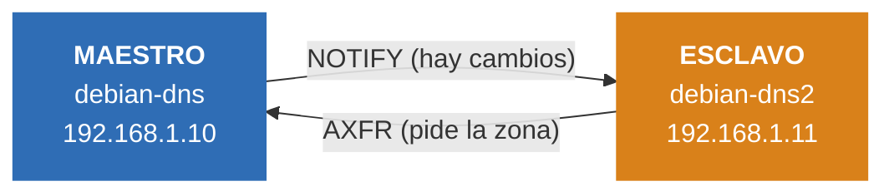

# Parte 6: Buenas prácticas del diseño de redes

*Grupo: Pau, Abde y Daniel · Módulo 0375 Servicios de red*

## 11. ¿Qué es lo recomendable a la hora de diseñar una infraestructura DNS? ¿A qué se refiere con el principio de separación estricta de funciones?

Lo recomendable es no montarlo todo en un solo servidor. Lo normal es tener dos servidores autoritativos (un primario y un secundario, mejor si están en máquinas distintas) y aparte los servidores recursivos para los equipos de la red.

La separación estricta de funciones quiere decir que cada servidor hace una sola cosa: o es autoritativo o es recursivo, pero no las dos a la vez. Así, si uno falla o recibe un ataque, el otro servicio sigue funcionando.

## 12. ¿Qué atienden los servidores autoritativos públicos? ¿Qué deberían tener totalmente desactivado?

Atienden las consultas que llegan desde Internet sobre las zonas de nuestro propio dominio, por ejemplo la IP de la web de la empresa.

Deben tener la recursividad totalmente desactivada (`recursion no;`). Si no, cualquiera podría usarlos para resolver dominios ajenos y se podrían aprovechar para ataques de amplificación DDoS. También se limita la transferencia de zona al servidor secundario con `allow-transfer`.

## 13. ¿Qué función cumplen los servidores recursivos internos o resolvers? ¿Con qué opción se restringe únicamente a los rangos IP de la organización?

Resuelven los nombres de cualquier dominio para los equipos de la red interna. Preguntan a los servidores raíz o a un forwarder y guardan la respuesta en caché para ir más rápido la próxima vez.

Para que solo contesten a los rangos de la organización se usa `allow-recursion`, por ejemplo:

```
allow-recursion { 127.0.0.1; 192.168.1.0/24; };
```

## Infografía: DNS maestro y esclavo con BIND9

Dominio `daniel.lan` · Debian 13 · BIND 9.20 · VMware

En la práctica montamos un servidor DNS esclavo (`debian-dns2`) que copia las zonas del maestro (`debian-dns`). Este es el resumen de lo que hicimos. El detalle paso a paso está en el [README principal](../README.md).



Zonas que se copian: `daniel.lan` y `1.168.192.in-addr.arpa`.

### Lo que hicimos

| Paso | Qué hicimos | Detalle |
|:---:|---|---|
| 1 | Creamos la VM del esclavo | `debian-dns2`, IP fija `192.168.1.11` en la red interna |
| 2 | Instalamos BIND9 | `apt install bind9 bind9utils bind9-doc` |
| 3 | Opciones del servidor | `allow-query` (localhost y `192.168.1.0/24`) y forwarders `1.1.1.1` y `8.8.8.8` |
| 4 | Zonas esclavas | `type slave` y `masters { 192.168.1.10; }` en `named.conf.local` |
| 5 | Permiso en el maestro | `allow-transfer` solo para `192.168.1.11`, y registros NS y A del esclavo |
| 6 | Subir el serial | `daniel.lan` de 3 a 4 y la inversa de 2 a 3. Si no, no hay transferencia |

### Comprobación

```
journalctl -xeu bind9                         →  "Transfer completed"
ls /var/cache/bind/slaves                     →  aparecen las dos zonas
dig @192.168.1.10 y @192.168.1.11 daniel.lan  →  misma respuesta
```
